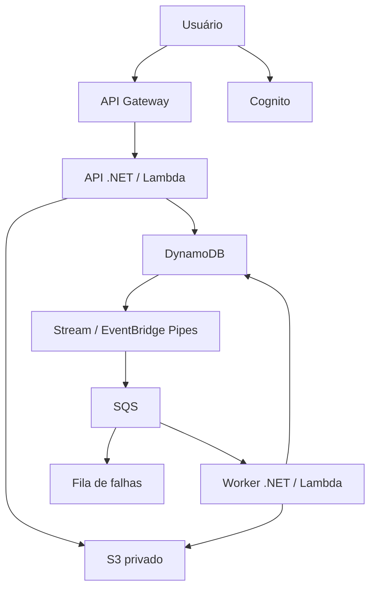

# TalumeDoc

**Clareza em cada arquivo.** Uma ferramenta da família **Talume**, desenvolvida por [Carlos Eduardo](https://www.linkedin.com/in/carlos-eduardo-a8bb50268/).

Aplicação de portfólio para receber arquivos CSV de produtos, validar registros em segundo plano e produzir relatórios de erros. Backend e worker em **C# / .NET 10**, infraestrutura em **AWS CDK / TypeScript**.

> Estado da entrega: implementação e testes locais disponíveis. A implantação em uma conta AWS e a validação real do Cognito, IAM e EventBridge Pipes devem ser realizadas seguindo [o guia de implantação](docs/DEPLOYMENT.md). O código não pressupõe uma infraestrutura já publicada.

## Experimente em poucos minutos

Instale o [.NET 10 SDK](https://dotnet.microsoft.com/download/dotnet/10.0), abra um terminal nesta pasta e execute:

```bash
dotnet run --project src/TalumeDoc.Api
```

Abra **http://localhost:5080** e clique em **Testar com um exemplo**. O exemplo tem seis registros: três válidos e três inválidos, com quatro ocorrências de erro. Consulte o relatório e baixe o CSV.

**No Windows:** abra `TalumeDoc.sln` no Visual Studio com suporte ao .NET 10, selecione `TalumeDoc.Api` como projeto de inicialização ou execute `scripts/run-local.ps1` no PowerShell.

O ambiente local usa um usuário de demonstração e persiste os arquivos em `src/TalumeDoc.Api/.talumedoc-data/`. Não precisa de AWS, Supabase, Node.js ou Docker. O modo local só funciona em `Development` e é bloqueado no AWS Lambda. Não exponha esse modo na internet.

Alternativa com Docker (receita incluída; requer Docker instalado):

```bash
docker compose up --build
```

O volume `talumedoc-data` preserva os dados entre reinicializações. `docker compose down` mantém o volume; remova-o somente se quiser apagar os dados locais.

## O que está implementado

- Painel responsivo em português, busca por nome, filtros e atualização automática.
- Temas claro e escuro, com preferência salva no navegador e detecção inicial do tema do sistema.
- Botão **Sobre o projeto** com autoria de Carlos Eduardo, LinkedIn e tecnologias utilizadas.
- Envio de um CSV por vez, com limite de **2 MiB / 10.000 registros**.
- Validação de cabeçalho, SKU obrigatório e único, nome, quantidade e preço.
- CSV com campos entre aspas, vírgulas e quebras de linha dentro de campos.
- Histórico dos **200 documentos mais recentes** por usuário.
- Relatório com prévia de 100 ocorrências e download de todas as ocorrências em CSV.
- Processamento assíncrono, controle de concorrência por documento e reenvio após falha operacional.
- Autenticação de produção com Cognito, OAuth 2.0 Authorization Code + PKCE e JWT validado no backend.
- Armazenamento privado, permissões por componente, métricas, alarmes e filas de falhas.
- Testes de regras, processamento, API, autorização e infraestrutura.
- Infraestrutura reproduzível e workflows de CI e implantação manual pelo GitHub Actions.

**Escopo:** a ferramenta valida os arquivos; ela não importa os produtos para um ERP, não extrai texto de PDF e não faz análise por IA.

## Interface

O painel tem sidebar, área de upload, indicadores, histórico filtrável e diálogo de relatório. Execute `npm run test:browser` para gerar capturas desktop e mobile em `docs/images/`. A revisão visual em Chromium não foi concluída neste ambiente; os fluxos da interface foram verificados por integração DOM com a API real.

## Arquitetura AWS



O frontend está em `wwwroot` e é servido pela própria API. Isso mantém o primeiro deploy em uma única URL HTTPS. Não há dependência de um servidor frontend separado, banco relacional ou serviços do Supabase.

| Pasta | Responsabilidade |
|---|---|
| `src/TalumeDoc.Core` | Regras, contratos, estados e processamento independente da AWS |
| `src/TalumeDoc.Infrastructure` | Adaptadores locais, S3 e DynamoDB |
| `src/TalumeDoc.Api` | API HTTP, autenticação e interface |
| `src/TalumeDoc.Worker` | Handler Lambda para SQS e respostas parciais por lote |
| `tests/TalumeDoc.Tests` | Testes C# de regras, API, autenticação e concorrência |
| `bin`, `lib`, `test` | Aplicação CDK, stack e testes da infraestrutura |
| `scripts` | Publicação, verificação e teste de navegador |
| `samples` | Arquivos válidos e arquivos com erros conhecidos |
| `docs` | Arquitetura, deploy, operação, segurança e roteiro de portfólio |

## Formato do arquivo

```csv
sku,nome,quantidade,preco
TAL-001,Caderno pontilhado,10,29.90
TAL-002,"Pasta, tamanho A4",8,12.00
```

UTF-8, separador vírgula, preço com ponto decimal. Cabeçalho nessa ordem, normalizado sem diferenciar maiúsculas/minúsculas. SKU sem diferenciar maiúsculas/minúsculas, até 64 caracteres; nome até 200; quantidade inteira não negativa; preço positivo até 999999999 com até duas casas. Linhas vazias são ignoradas. O relatório numera registros lógicos, contando o cabeçalho como 1; uma quebra de linha dentro de aspas não inicia outro registro.

`Completed` indica que a análise terminou e pode conter registros inválidos. `Rejected` indica um erro no formato, tamanho, quantidade de registros ou codificação do documento. `Failed` representa uma falha operacional, não um erro nos dados.

## Testes

```bash
dotnet restore TalumeDoc.sln --locked-mode
dotnet test TalumeDoc.sln
npm ci
npm run build
npm test -- --runInBand
```

Node.js 22+ é necessário para o CDK. `npm run test:ui` testa o fluxo da interface contra a API local sem exigir Chromium. Para testar a interface, após compilar o .NET:

```bash
npx playwright install chromium
npm run test:browser
```

O teste de navegador inicia sua própria instância da API, envia amostras, confere o relatório e o download, testa busca e layout mobile, captura imagens e limpa seus dados temporários.

## Documentação

- [Arquitetura e decisões técnicas](docs/ARCHITECTURE.md)
- [Implantação AWS e configuração do GitHub Actions](docs/DEPLOYMENT.md)
- [Operação, custos, recuperação e remoção de recursos](docs/OPERATIONS.md)
- [Segurança e limites](docs/SECURITY.md)
- [API e exemplos de chamadas](docs/API.md)
- [Publicação no GitHub e apresentação no portfólio](docs/PORTFOLIO.md)
- [Validação realizada nesta entrega](docs/VERIFICATION.md)

## Créditos e licença

Aplicação TalumeDoc: Carlos Eduardo. A base de infraestrutura foi inicializada com o **Traceability v1.0.4**, criado por **Lars Andersson**, usando a skill AWS CDK Project Init, também criada por Lars Andersson. A licença Beer-Ware original foi preservada em [LICENSE](LICENSE). A atribuição do starter não altera a autoria da aplicação TalumeDoc.

**Created by Lars Andersson. This skill uses the Traceability starter project, also created by Lars Andersson.**

**Read more about the Traceability starter project:** [Where the hell is the git project that owns this?](https://lars-andersson.medium.com/where-the-hell-is-the-git-project-that-owns-this-550bd96dd230)
