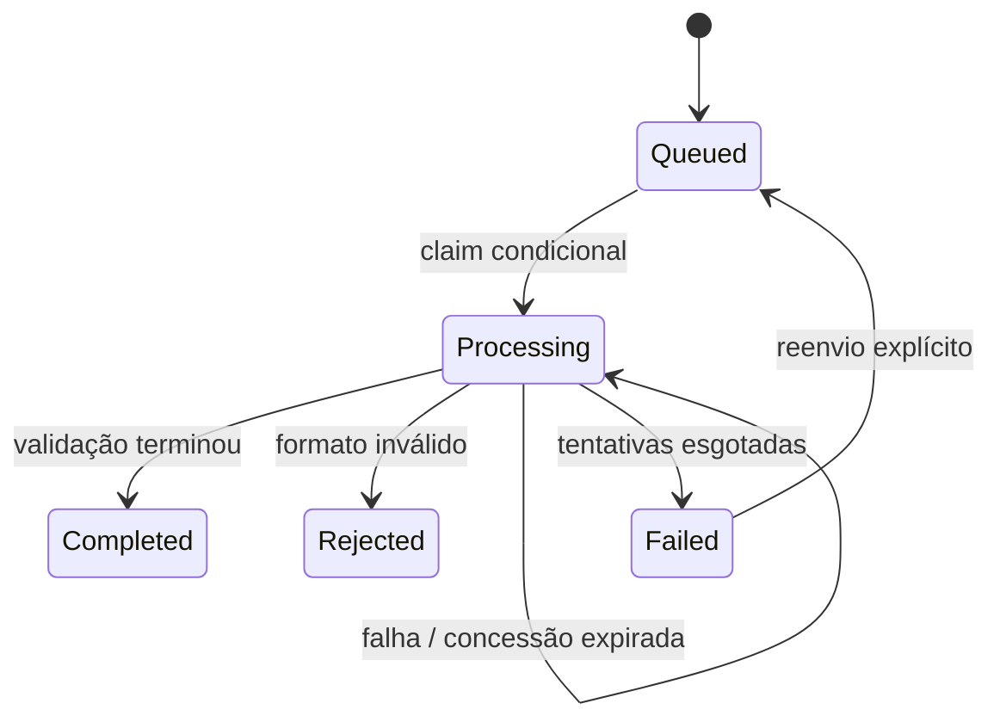

# Arquitetura e decisões

## Fluxo de escrita

1. A API autentica o usuário e usa exclusivamente o `sub` do token como proprietário. O cliente nunca escolhe `ownerId`.
2. Um identificador UUIDv7 é criado e usado na chave do S3. O nome informado pelo usuário é somente metadado.
3. A API grava o CSV no S3 e depois registra o documento como `Queued` no DynamoDB.
4. O Stream emite a alteração. EventBridge Pipes seleciona imagens com `status=Queued`, transforma a chave em uma mensagem pequena e envia ao SQS.
5. O worker adquire uma concessão de processamento por atualização condicional, valida o CSV, escreve um relatório específico daquela tentativa e finaliza o estado usando o mesmo token.
6. A interface consulta a API periodicamente. O relatório é acessado pela API após verificar o proprietário.

A API não faz duas gravações independentes em DynamoDB e SQS. O Stream representa a intenção durável de processar o documento. Se a gravação no DynamoDB falhar após o upload, o objeto órfão do S3 será removido pelo ciclo de vida de 30 dias. Não há transação distribuída entre S3 e DynamoDB.

## Estados

Concessão de 90 segundos, Lambda com timeout de 30 segundos e visibilidade SQS de 180 segundos. A atualização condicional compara a versão do documento e o token de processamento. Um worker antigo não pode finalizar o resultado de um worker mais novo. O relatório usa uma chave por tentativa para que uma execução atrasada não sobrescreva o relatório vencedor.

Processamento at-least-once: mensagens duplicadas são esperadas. Um documento terminal não é processado novamente. Uma mensagem durante uma concessão ativa falha para ser tentada depois. Após cinco falhas tratadas, o documento fica `Failed`; se a quinta execução terminar abruptamente, a API apresenta a concessão expirada como falha recuperável. SQS controla tentativas de entrega independentemente de `Attempts` (aquisições efetivas da concessão).

## Modelo de dados

Tabela com chave composta `ownerId` + `id`. `id` é UUIDv7 em formato hexadecimal; a consulta por proprietário em ordem decrescente retorna os envios recentes. Os atributos `status` e `version` apoiam o Stream e a concorrência; `payload` contém o documento serializado. Não há `Scan` no caminho da API. `expiresAt` aplica retenção de aproximadamente 30 dias; TTL do DynamoDB é assíncrono.

Relatórios não ficam na tabela: uma lista grande de erros poderia ultrapassar o limite por item. S3 guarda tanto os arquivos como os relatórios. O frontend recebe somente metadados públicos, sem chaves internas de objetos, token de concessão ou proprietário.

## Escolhas de escopo

- **.NET 10:** mesma linguagem para API, regras, armazenamento e worker.
- **DynamoDB:** acesso principal previsível por usuário e documento; não há necessidade de joins neste domínio.
- **Lambda e SQS:** trabalho assíncrono com escala e reentrega administradas.
- **CDK em TypeScript:** compatibilidade com o inicializador escolhido; as regras da aplicação continuam em C#.
- **HTML/CSS/JavaScript:** frontend pequeno, servido na mesma origem da API. Reduz etapas de implantação; não é Blazor.
- **Upload passando pela API:** apropriado ao limite de 2 MiB. Arquivos grandes exigiriam upload direto ao S3 com uma política assinada e um protocolo de confirmação.
- **Adaptadores locais:** reutilizam regras e contratos, mas não simulam IAM, latência, filas ou falhas reais da AWS.
- **Supabase:** não é dependência. Acrescentá-lo aqui duplicaria responsabilidades sem necessidade funcional.

## Limitações assumidas

Os 200 documentos mais recentes são retornados sem paginação; o limite deverá virar paginação por cursor em uma evolução. A API não deduplica uploads HTTP repetidos: cada envio cria um novo documento. A idempotência implementada é a do processamento de cada documento. O rate limit por usuário é local à instância da API; API Gateway fornece um limite agregado de tráfego, não uma cota financeira por conta.

Streams retêm eventos por 24 horas. O Pipe usa TRIM_HORIZON e idade máxima de 23 horas com fila de falhas. Interrupções mais longas precisam de reconciliação conforme o runbook. O modo local é de processo único; não deve ser escalado horizontalmente.

## Referências

- https://docs.aws.amazon.com/lambda/latest/dg/csharp-package-asp.html
- https://docs.aws.amazon.com/lambda/latest/dg/with-sqs.html
- https://docs.aws.amazon.com/eventbridge/latest/userguide/eb-pipes-dynamodb.html
- https://docs.aws.amazon.com/eventbridge/latest/userguide/eb-pipes-input-transformation.html
