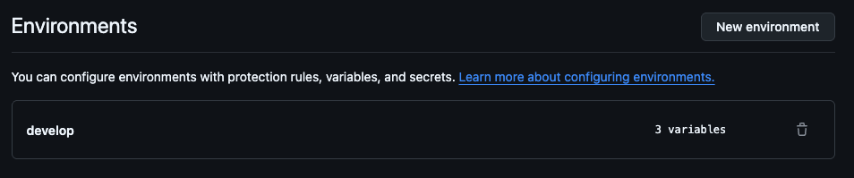
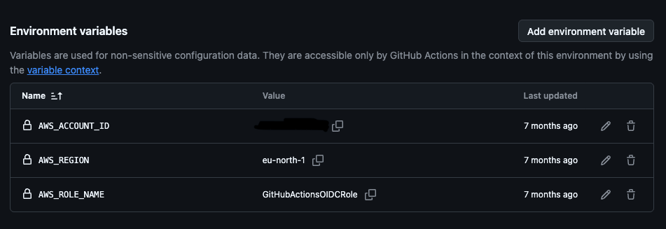

# Implantação na AWS

## Pré-requisitos

.NET 10 SDK, Node.js 22+, npm, AWS CLI v2 e uma conta AWS com permissão para implantar os recursos da stack. Prefira autenticação local pelo IAM Identity Center (`aws configure sso`, seguido de `aws sso login`). Não coloque chaves de acesso no código ou em arquivos versionados.

Escolha uma região em que os serviços usados estejam disponíveis. Os comandos usam `us-east-1` como exemplo, não como requisito de localização dos seus dados. Execute `aws sts get-caller-identity` para confirmar a conta antes do bootstrap/deploy. Nenhum recurso já foi criado por esta entrega.

## Implantação manual

Execute na raiz do repositório:

```bash
dotnet test TalumeDoc.sln
npm ci
npm run build
npm test -- --runInBand
bash scripts/publish.sh
npx cdk synth
```

No Windows, substitua `bash scripts/publish.sh` por `./scripts/publish.ps1`.

Configure o perfil e a região desejados no AWS CLI. Substitua os placeholders:

```bash
npx cdk bootstrap aws://SEU_ACCOUNT_ID/SUA_REGIAO
npx cdk diff TalumeDoc
npx cdk deploy TalumeDoc --outputs-file cdk-outputs.json
```

O bootstrap também cria recursos e pode exigir permissões administrativas de infraestrutura. Revise as alterações de IAM mostradas pelo CDK. O deploy inclui bucket privado, tabela, funções, filas, Pipe, Cognito, API Gateway, logs, dashboard e alarmes; esses recursos podem gerar cobranças.

O output `ApplicationUrl` é a URL HTTPS do TalumeDoc. Abra-a, clique em entrar, crie uma conta e confirme o e-mail pelo Cognito. O login usa PKCE e não precisa de um segredo de cliente no navegador. O domínio Cognito usa o prefixo `talumedoc-CONTA-REGIAO` (uma implantação com esse prefixo por conta/região).

Para receber alarmes operacionais por e-mail, acrescente `-c alarmEmail=SEU_EMAIL` ao deploy e confirme a inscrição SNS recebida. Sem essa configuração, os alarmes continuam visíveis no CloudWatch e publicam no tópico, mas nenhum e-mail é cadastrado automaticamente.

## Validação após o primeiro deploy

1. Confirme que `/health` retorna `ok` e a tela inicial carrega.
2. Acesse `/api/documents/` sem token e confirme HTTP 401.
3. Cadastre e confirme uma conta, faça login e envie os dois exemplos.
4. Aguarde os resultados e confirme: válido = 3 aceitos; exemplo com erros = 3 válidos, 3 inválidos, 4 ocorrências.
5. Confirme no CloudWatch os logs do worker, ausência de mensagens nas filas de falhas e processamento do Pipe.
6. Entre com outra conta e confirme que ela não vê os documentos anteriores.
7. Teste a saída e uma nova entrada. Registre as evidências reais para o portfólio.

A validação local e o `cdk synth` não substituem esses testes: IAM, callbacks Cognito, entrega do Pipe, limites da conta e disponibilidade regional só podem ser confirmados na conta de destino.

## GitHub Actions (opcional)

**This setup is only required for automatic AWS deployment through GitHub Actions. It is not required to initialize, build, test, or work with the project locally.**

O workflow de CI roda nos pushes de `main`/`develop` e pull requests. O workflow **Deploy AWS** é acionado manualmente pela aba Actions e usa o ambiente `develop`. A execução automatiza a implantação após seu acionamento; não faz deploy em cada push.

1. Na conta AWS de destino, confirme o provedor OIDC `https://token.actions.githubusercontent.com` com audience `sts.amazonaws.com`.
2. Configure a role **GitHubActionsOIDCRole**, limitando a relação de confiança ao repositório TalumeDoc e ao ambiente `develop`. Use o formato de `sub` emitido pelo seu repositório; a documentação atual do GitHub descreve também formatos com IDs imutáveis. Não copie um exemplo sem conferir esse formato.
3. Em **Settings → Environments → develop**, cadastre `AWS_ACCOUNT_ID`, `AWS_REGION` e `AWS_ROLE_NAME=GitHubActionsOIDCRole`. Os valores dependem da sua conta; não há conta pré-configurada neste projeto.
4. Mantenha o nome `develop` alinhado com `environment: develop` em `.github/workflows/deploy-ts.yml`. Se desejar, configure aprovação do ambiente nas opções do GitHub.
5. O workflow usa `permissions: id-token: write` e `contents: read` e assume `arn:aws:iam::<AWS_ACCOUNT_ID>:role/<AWS_ROLE_NAME>`, obtendo credenciais temporárias. Não crie secrets `AWS_ACCESS_KEY_ID` ou `AWS_SECRET_ACCESS_KEY` para esse fluxo.
6. Faça o bootstrap CDK da conta/região antes do primeiro deploy. Conceda à role somente as permissões necessárias à implantação, incluindo assumir as roles de bootstrap adequadas, em conjunto com uma role de execução CloudFormation limitada aos serviços deste projeto.

Exemplo de GitHub **Environments** com ambiente `develop` e três variáveis:



Exemplo das variáveis `AWS_ACCOUNT_ID`, `AWS_REGION` e `AWS_ROLE_NAME`. O account ID está intencionalmente oculto; todos os valores exibidos são exemplos:



## Referências

- https://docs.github.com/en/actions/how-tos/secure-your-work/security-harden-deployments/oidc-in-aws
- https://docs.aws.amazon.com/cdk/v2/guide/bootstrapping.html
- https://docs.aws.amazon.com/lambda/latest/dg/lambda-csharp.html

## Origem do starter

O inicializador gerou `bin/talume-doc.ts`, `lib/talume-doc-stack.ts`, `test/talume-doc.test.ts`, a classe `TalumeDocStack` e a stack `TalumeDoc`. A stack foi ampliada para a aplicação completa.

**Created by Lars Andersson. This skill uses the Traceability starter project, also created by Lars Andersson.**

**Read more about the Traceability starter project:** [Where the hell is the git project that owns this?](https://lars-andersson.medium.com/where-the-hell-is-the-git-project-that-owns-this-550bd96dd230)
